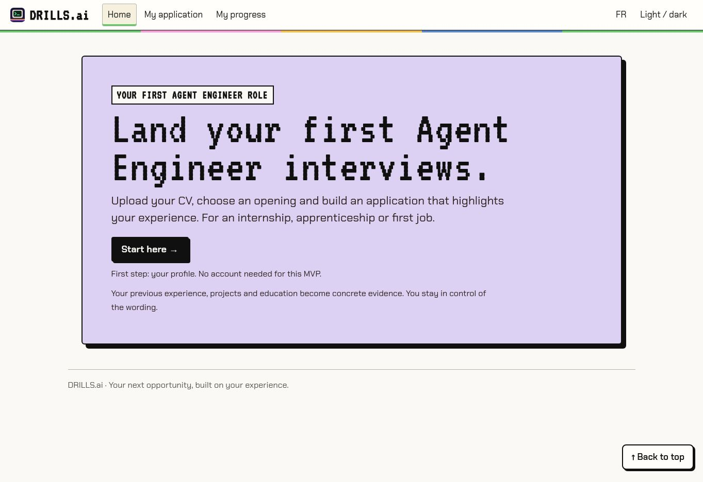
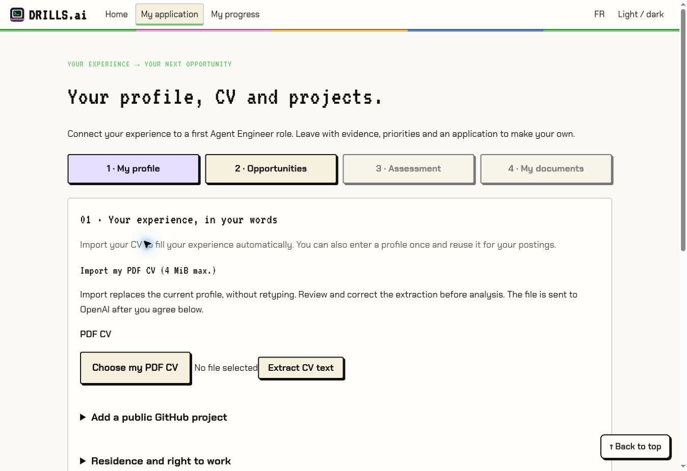
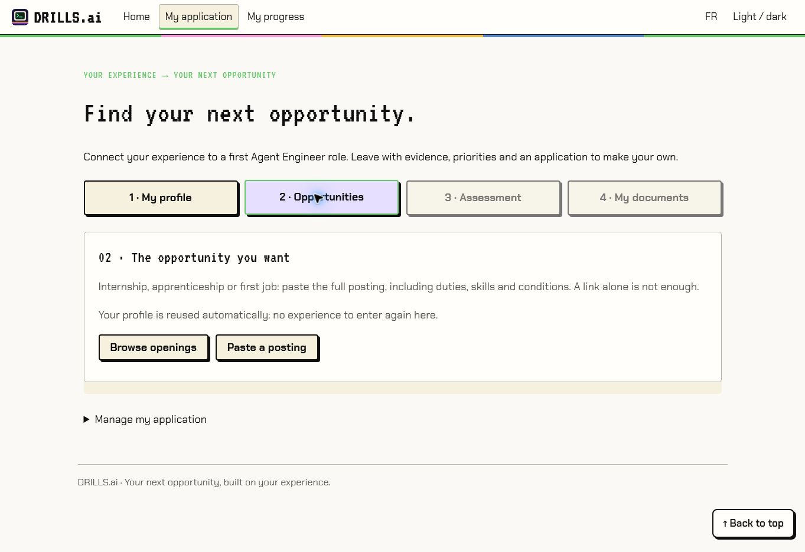
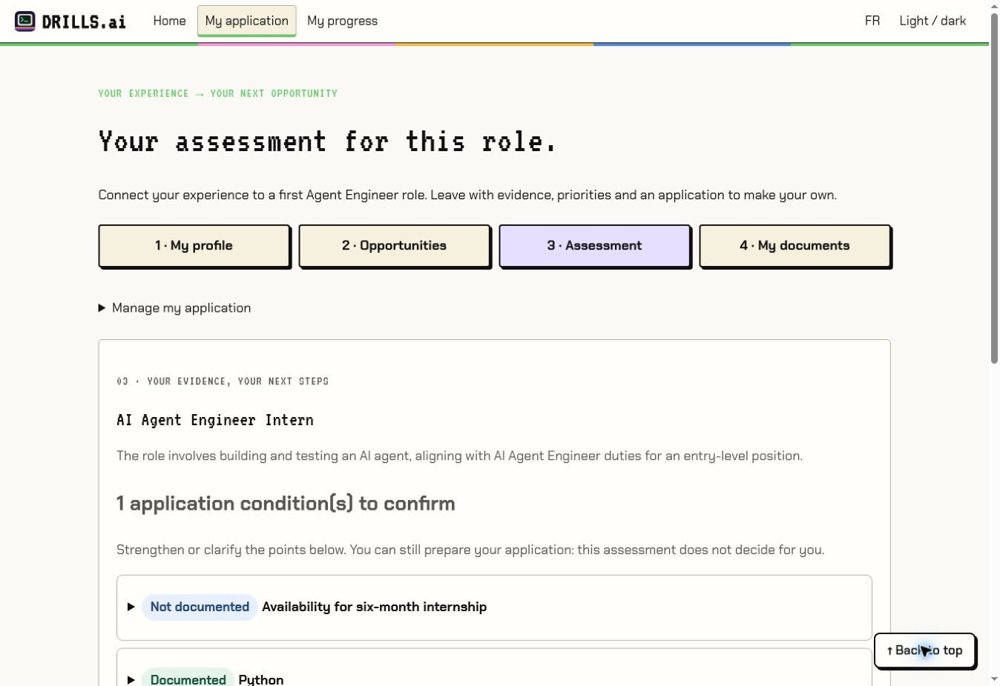
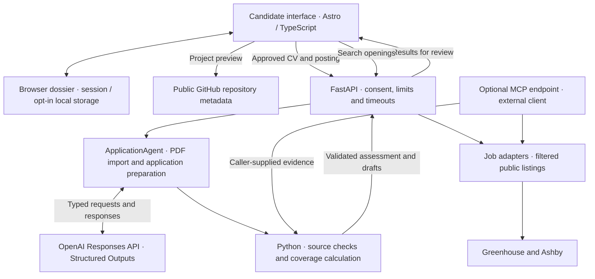
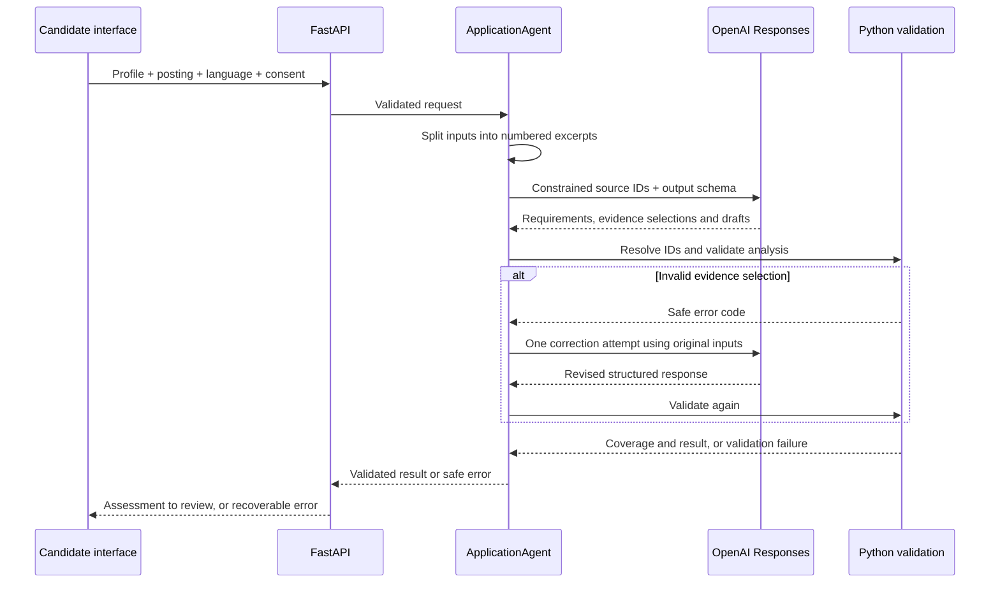

# DRILLS.ai

**Land your first Agent Engineer interviews.**

Upload your CV, choose an opening, and build an application that highlights your experience. For an internship, apprenticeship, or first job.

[Try the app in English](https://mialy333.github.io/drills.ai/en/) · [Essayer en français](https://mialy333.github.io/drills.ai/fr/) · [100-second demo script (French)](docs/DEMO.md)

Built during the **OpenAI Devday hackathon · Impact → New Opportunities → Jobs**, with a build-in-public approach.



## Why Drills?

Career changers often have years of professional experience, technical training, and personal projects—but still struggle to tell whether they are ready to apply. Should they learn another framework, or explain their existing work more clearly?

Drills connects a candidate's experience to a specific opening: what is supported by their profile, what needs clarification, and what to do next. It helps turn that assessment into an editable application and a concrete path to applying.

The target user is **a career changer with some development foundations and projects**, looking for a first Agent Engineer opportunity. The goal is to help them obtain an interview; the product does not promise interviews or employment.

## The candidate journey

| Step | What the candidate does | What Drills provides |
| --- | --- | --- |
| **1 · Profile** | Import a PDF CV or enter experience; optionally add a public GitHub project | A reusable profile, with extracted text to review and an explicit description of personal project contributions |
| **2 · Opportunities** | Browse openings or paste a full posting | Public listings, location filtering, and the original application link when available |
| **3 · Assessment** | Compare the selected opening with the saved profile | Documented skills, evidence gaps, separate eligibility conditions, and next actions |
| **4 · Documents** | Review and edit the application | A targeted CV editor, an introduction draft, PDF printing, and a link back to the application website |
| **Progress** | Record what happened after applying | Analysed postings, manually updated statuses, sent dates, and notes |

The profile is reused across postings. Switching between French and English preserves the dossier; it does not automatically translate existing drafts or source text. Exporting a CV or opening an application link never marks an application as sent.

**The hackathon scope is now frozen around these core features.** Interview preparation, courses, and Python exercises are no longer part of the public journey. The next step is user testing, not adding another feature set.

## Inside the application

These are screenshots of the deployed English interface, captured on October 25, 2026. The assessment uses the built-in **fictional candidate and fictional posting**, processed through a real OpenAI request. It is an illustrative result, not evidence of hiring outcomes. No real candidate CV is shown.

### A profile entered once

Import a CV, review the extracted experience, and optionally add a public GitHub project or country-specific work eligibility declarations.



### Two ways to find an opportunity

Browse available openings or bring a posting you have already found. Search controls appear only when requested.



### Evidence before confidence

The assessment separates skills from application conditions. Unresolved eligibility remains visible even when the candidate documents many of the required skills.



## Product architecture

The frontend is a bilingual **Astro + TypeScript** application with a **Tiptap** CV editor. A **FastAPI** backend handles OpenAI requests, public job feeds, validation, and optional MCP access. The candidate dossier stays in browser storage; there is no account database in this MVP.



Public GitHub metadata is read directly by the browser. Job discovery uses backend adapters. MCP clients can use the shared job tools and scoring rules, but cannot read a dossier stored in a user's browser.

### The active agent and its boundaries

`ApplicationAgent` is the model-facing component in the current candidate workflow. Its two entry points share the Responses API helper; PDF extraction is a separate operation from the profile/posting assessment.

| Component | Responsibility | Implementation |
| --- | --- | --- |
| `ApplicationAgent.import_pdf()` | Extract factual CV text for the candidate to review | PDF input to OpenAI, parsed into `ImportedProfile` |
| `ApplicationAgent.prepare()` | Identify role requirements, relate supplied experience to them, and draft application text | OpenAI Responses API with Pydantic Structured Outputs |
| `source_excerpts()` / `resolve_selection()` | Assign source IDs and resolve model-selected IDs back to original text | Deterministic Python |
| `validate_analysis()` / `calculate_match()` | Check references and consistency, then calculate documented skill coverage | Deterministic Python; not another LLM agent |
| Job adapters | Read, filter, and deduplicate public openings | Greenhouse and Ashby APIs; no model-generated listings |
| Browser editor and tracker | Keep the candidate in control of wording, export, and application status | Tiptap and validated browser state |



There is at most one correction attempt within the endpoint deadline. A persistent failure returns an error, not a fabricated score. These checks validate structure and source presence; they do not independently establish semantic correctness or candidate skill mastery.

### The original multi-agent prototype

The repository also preserves the earlier learning-product architecture:

| Archived component | Original role |
| --- | --- |
| `AnalystAgent` | Extract skills from a job description |
| `CoachAgent` | Build a learning roadmap |
| `DrillCreatorAgent` | Draft a targeted Python exercise and test harness |
| `ValidatorAgent` | Run static checks and model-assisted review |
| `DrillOrchestrator` | Coordinate the four stages |

This pipeline explains the project's development history. **It is not the current candidate assessment pipeline.** `/api/drills` and the retired interview endpoints return HTTP 410. The current public workflow does not use Agents SDK, Realtime, or Web Search, and should not be described as four autonomous agents collaborating in production.

## OpenAI and connected services

| Integration | What is implemented |
| --- | --- |
| **OpenAI Responses API** | PDF CV extraction, profile/posting analysis, and editable application drafts |
| **Structured Outputs + Pydantic** | Typed outputs and constrained evidence selections |
| **Greenhouse + Ashby** | A limited selection of public company job boards, filtered for relevant junior/internship opportunities |
| **GitHub public API** | Repository metadata preview with candidate-confirmed personal contribution; no code audit |
| **MCP** | Optional `/mcp/` server exposing `search_jobs`, `get_job`, and `score_documented_match` |

The product calls the **OpenAI API**, not a ChatGPT conversation. A compatible MCP client—including ChatGPT when configured appropriately—requires a separate connection and tool-discovery test. Exposing an endpoint does not mean that connection has been made.

The MCP tools do not make paid model calls, access browser dossiers, write external data, or submit applications. `score_documented_match` validates and scores caller-supplied requirements and evidence; it does not independently choose or semantically verify those requirements.

Job discovery is not an exhaustive market database or personalised ranking. Some searches may return no suitable openings. A GitHub repository's metadata is not proof of authorship or technical proficiency.

## Understanding the assessment

The percentage measures **documented coverage of the skills extracted from one posting**, not hiring probability. Priority weights are 3/2/1; evidence credit is 1 for documented, 0.5 for partial, and 0 for not documented. The 60% threshold is a product heuristic, not a recruiter-calibrated metric.

Eligibility is assessed separately. A high skill score does not override unresolved enrolment, availability, or work-authorisation conditions. Residence alone does not establish a right to work, and a candidate declaration is not legal verification. Out-of-scope or uncertain roles receive no numeric score.

The model chooses original source IDs rather than rewriting quotations. This reduces invented citations, but source presence does not guarantee relevance, accurate interpretation, or a truthful CV. Candidates must review all generated text before submitting it.

## Data and MVP boundaries

- **Empty by default:** a new browser starts with no candidate dossier. The built-in example is explicitly fictional and does not simulate a successful AI result.
- **Browser storage:** profile, drafts, export contact details, and tracking are held in session storage with a one-day expiry, or optional local storage for 30 days after modification. There are no accounts or cross-device sync.
- **Consent-based processing:** approved profile/posting inputs go to the backend and OpenAI. PDFs are processed in memory without application-level disk persistence. Contact details added separately in the export editor stay in the browser; details already inside an uploaded CV are part of the PDF input.
- **Provider processing:** Responses calls use `store=False`; this does not remove all provider processing or retention policies.
- **Deletion:** clearing the dossier removes it from that browser. It does not delete downloaded files, other browsers' data, or previous provider processing.
- **Demo protections:** bounded requests, timeouts, rate limits, and concurrency limits are implemented. They are not authentication, a spending cap, or a production security certification.
- **Candidate control:** no candidate code is executed and no application is submitted automatically.

To reset a demo session, open [the reset link](https://mialy333.github.io/drills.ai/en/?reset=1) in the browser concerned. Share the ordinary app link with new users.

## Run locally

Requirements: **Node.js 22**, **Python 3.12**, and `uv` or an equivalent Python environment.

```bash
git clone https://github.com/Mialy333/drills.ai.git
cd drills.ai
git switch main
npm ci
uv venv --python 3.12 .venv
source .venv/bin/activate
uv pip install -r requirements-devday.txt -r requirements-mcp.txt
```

Set `OPENAI_API_KEY` in an ignored `.env` file or the backend environment. Never put the key in a `PUBLIC_` variable. `OPENAI_APPLICATION_MODEL` overrides the code's default, `gpt-4o-2024-08-06`; model access depends on the OpenAI project.

Backend terminal:

```bash
source .venv/bin/activate
python -m uvicorn api.main:app --reload --port 8000
```

Frontend terminal:

```bash
npm run dev -- --port 4321 --strictPort
```

Open <http://localhost:4321/drills.ai/en/>. To enable MCP locally:

```bash
DRILLS_ENABLE_MCP=true python -m uvicorn api.main:app --reload --port 8000
```

The MCP endpoint is `http://localhost:8000/mcp/`.

## Test and deploy

```bash
python -m pytest -q
npm run test:contracts
npm run build
npm run test:ui
```

At the final MVP consolidation: **114 Python tests and 63 frontend tests passed**, together with the static build and public-content checks. API unit tests mock OpenAI. They do not establish live output quality or compatibility with every browser. The screenshot session additionally exercised one real fictional-profile assessment on the deployed app.

| Layer | Deployment |
| --- | --- |
| Frontend | GitHub Pages, Astro base path `/drills.ai/` |
| API | Render, configured in `render.yaml` |
| Frontend API origin | Repository Actions variable `DRILLS_API_URL`, passed as `PUBLIC_DRILLS_API_URL` during build |
| OpenAI secret | `OPENAI_API_KEY` in the backend environment only |

`Deploy to GitHub Pages` runs on pushes to `main` or manual dispatch. The `github-pages` environment must allow the publishing branch. The configured API is <https://drills-ai-api.onrender.com>; `/health` checks service availability and configuration, not a complete OpenAI request.

**`main` is the product reference branch.** `feat/hackathon-mvp` remains a temporary compatibility mirror for the existing Render service. See [branch consolidation and deployment transition (French)](docs/BRANCHES.md) before removing deployment branches.

## From Saturday's prototype to Sunday's MVP

| Stage | Progress |
| --- | --- |
| **Saturday, October 24, 2026** | Exercise-oriented experience, specialised agents, validation work, and FastAPI integration |
| **Sunday's pivot** | Focus on career changers applying for their first Agent Engineer opportunity |
| **Building the journey** | PDF import, evidence-based assessment, job feeds, GitHub metadata, editable CV, application links, and tracking |
| **Feedback and simplification** | Reused profiles, shared FR/EN state, clearer eligibility, distinct journey steps, and removal of interview preparation |
| **Final scope** | Help candidates prepare and send a credible application; freeze features and move to user testing |

ChatGPT/Codex assisted development and iteration during the hackathon. That development workflow is distinct from the OpenAI API calls made for candidates inside the product.

## Next: real users

The core features are in place. The next step is to test the existing journey with career changers like the creator, using their own profiles and target openings—with consent.

The questions are practical: can users finish without help, understand the assessment, recognise their own voice in the edited application, and reach the point of applying? Track necessary corrections, time spent, and applications actually sent. Hiring impact has not yet been established.

No additional feature expansion is planned before this feedback round.

## Code map

| Path | Purpose |
| --- | --- |
| `src/pages/[lang]/` | English and French pages |
| `src/scripts/application.ts` | Candidate journey and document editing |
| `src/lib/application-state.ts` | Validated browser dossier and retention |
| `src/lib/application-history.ts` | Application tracking |
| `src/ai_generator/application.py` | Active agent, evidence validation, and scoring |
| `src/ai_generator/orchestrator.py`, `agents/` | Original multi-agent learning prototype |
| `src/integrations/jobs.py` | Public job-board adapters |
| `api/main.py`, `api/mcp_app.py` | HTTP API and optional MCP server |
| `tests/` | Python, contract, and UI checks |
| `docs/images/` | Real application screenshots without personal candidate data |
